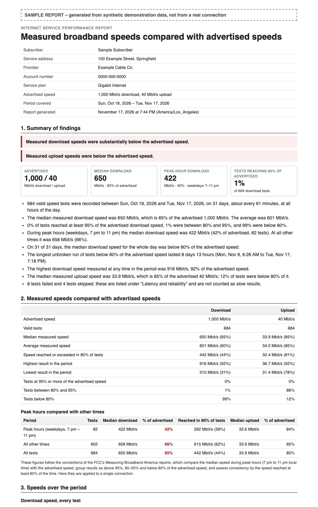

# ISPy — *I spy on my ISP*

**ISPy** is a LuCI app for OpenWrt and GL.iNet routers. It runs internet
speed tests on a schedule, shows what your ISP actually delivers and when, and
produces a **printable report** comparing that with the advertised speed, for
your provider's support team or a complaint to a regulator.
It was built for the **GL.iNet GL-BE9300 (Flint 3)** but works on any OpenWrt
21.02+ router with LuCI. On GL.iNet routers it also appears in GL's own admin
panel, under **Applications → ISPy Speed Monitor**.


<sub>Dashboard with 7 days of demo data.</sub>

## Features

- **Scheduled tests** at any interval (5 min – 1 week), around the clock, with
  a random offset so tests don't always land on the same minute.
- **Three test engines**:
  - **Cloudflare**: built in, needs only `curl`.
  - **Ookla speedtest CLI**: used automatically if installed.
  - **librespeed-cli**: used automatically if installed.
- **Dashboard**: download and upload over time against your plan, latency and
  an A+…F bufferbloat grade, speed by hour of day, a weekday × hour heatmap,
  and statistics for every metric. Hover or use the arrow keys on a chart.
- **Report** for your ISP or a regulator (see below).
- **Two places to use it**: LuCI, and on GL.iNet routers the normal GL admin
  panel, with the same pages and your usual login.
- **Evidence recorded with every test**, not just a speed:
  - the total traffic on the WAN port while the test ran,
  - what else was using the connection just before it,
  - how busy the router's processor was,
  - the WAN port's link speed, and the test server.
- **Honest failures**: a test the server refused or throttled is stored as
  *failed*, never as a slow result.
- **Polite to your household**: can skip a scheduled test while the line is busy.
- **Plain CSV storage** with export, kept across firmware upgrades.
- **Automatic copy to a USB drive**: after every test, the results and an
  up-to-date report file are saved to a drive plugged into the router.

## The report

**Services → ISPy Speed Monitor → Report** builds a document from your results
that you can print, save as PDF, or download as a single HTML file.


<sub>Sample built from synthetic data. Full sample: [docs/sample-report.pdf](docs/sample-report.pdf).</sub>

It contains:

1. **Summary of findings**: a plain statement of the result, the key figures,
   and the facts behind them. If the line delivers what was advertised, the
   report says so.
2. **Measured vs. advertised**: median, average, best and worst, and the share
   of tests at ≥95%, 80–95% and <80% of the advertised speed, with peak hours
   (weekdays 7–11 pm) shown separately.
3. **Charts**: every test over the period, day-by-day medians, how often each
   speed level occurred, and speed by time of day.
4. **Day-by-day table** and a list of **sustained periods** below 80%.
5. **Latency and reliability**, including every test that failed and why.
6. **How the measurements were made**, with a table that takes the usual
   explanations for a slow speed test and shows what was recorded about each:

   | "It's probably…" | What the report shows |
   |---|---|
   | your Wi-Fi or a slow device | tests run on the router, on its wired WAN port; link speed recorded |
   | someone else using the connection | traffic before each test recorded; reported speed counts all WAN traffic |
   | your router being too slow | processor load during each test; the highest speed it did measure |
   | the test server | server recorded for every test |

The peak period, the 95% / 80% bands and the "speed reached 80% of the time"
measure follow the conventions the FCC used in its
[Measuring Broadband America](https://www.fcc.gov/general/measuring-broadband-america)
reports (2011–2024), applied to one connection. That programme has ended, but
its reports remain the FCC's own yardstick for "delivers what it advertises".

### Automatic copy on a USB drive

Plug a drive into the router and pick its folder under **Settings → Storage →
Copy to a USB drive**; the page lists the drives it finds (on GL.iNet
firmware a drive appears as `/tmp/mountd/disk1_part1`). After every test
ISPy then saves two files there:

| File | What it is |
|---|---|
| `ispy-results.csv` | every result the router holds, same format as below |
| `ispy-report.html` | the report as one self-contained file |

`ispy-report.html` needs neither the router nor a network connection. Open it
in any browser, choose the period, add your statement, and use **Print / save
as PDF**. It is built by the same code as the Report page, from the same
data, so the two say the same thing.

- **The router keeps the master copy.** While the drive is unplugged, the copy
  is skipped and the dashboard says so; nothing is written anywhere else and
  no result is lost. The next test after the drive is back brings the files up
  to date, or press **Save to the drive now** on the Report page.
- **Clear history** does not delete the copy: the files on the drive are kept
  under a dated name (`ispy-results-until-<date>.csv`).
- The drive has to be mounted writable by the router. Which formats work
  (FAT32, exFAT, NTFS, ext4) depends on the firmware: if the router's own
  file sharing can write to the drive, ISPy can too.
- The report file contains the details entered under **My plan** (name,
  address, account number), so treat the drive accordingly.

### Using it to make your case

1. **Set it up properly.** Under **Settings → My plan** enter the advertised
   speeds and your provider and account details. In the US, use the "typical"
   download and upload speeds from the plan's
   [Broadband Facts label](https://www.fcc.gov/broadbandlabels).
2. **Collect at least two weeks**, ideally a month, at an hourly interval.
   The report marks itself *preliminary* before 7 days or 50 tests.
3. **Check the result once by hand.** Plug a computer into the router by cable
   and run a speed test while nobody else is online. If it agrees with ISPy,
   say so in the report's statement box.
4. **Go to your provider first.** Send the PDF and the CSV, ask for a ticket
   number, and note the date. Add that to the statement if you escalate.
5. **Then the regulator.** In the US you can file a free informal complaint at
   the [FCC Consumer Complaint Center](https://consumercomplaints.fcc.gov).
   The FCC forwards it to the provider, which must
   [answer you and the FCC in writing within 30 days](https://www.fcc.gov/consumers/guides/filing-informal-complaint).
   The FCC does not investigate individual informal complaints itself; the
   value is that the provider has to respond on the record. Your state
   attorney general or utility commission may also take complaints.

The report states measurements. It is not legal advice, and many plans are
sold as "up to" a speed.

## Install

### 1. Enable LuCI (GL.iNet firmware)

GL.iNet firmware ships its own web UI, and LuCI is an optional add-on that is
not installed out of the box. In the GL admin panel open **System → Advanced
Settings** and install LuCI, or run over SSH what that button runs:

```sh
sh /usr/bin/init_luci.sh web
```

LuCI is then at `http://192.168.8.1:8080/cgi-bin/luci` (the GL admin panel
stays on port 80). Log in as `root` with the router's admin password.
Checked on a GL-BE9300 with firmware 4.10.1.

On stock OpenWrt, LuCI is normally already there at
`http://192.168.1.1/cgi-bin/luci`; if not, `opkg update && opkg install luci`.

### 2. Install ISPy

Download the latest `luci-app-ispy_*_all.ipk` from
[Releases](https://github.com/chaffed/luci-app-ispy/releases), then:

```sh
scp -O luci-app-ispy_*_all.ipk root@192.168.8.1:/tmp/
ssh root@192.168.8.1 'opkg update && opkg install /tmp/luci-app-ispy_*_all.ipk'
```

(`-O` makes `scp` use the legacy protocol, because OpenWrt has no SFTP server by default.)

Open **Services → ISPy Speed Monitor** in LuCI or, on GL.iNet firmware,
**Applications → ISPy Speed Monitor** in the GL admin panel (see below).
Scheduled testing starts enabled with a 1-hour interval, and the first test
runs about two minutes after install.

The package is architecture-independent (shell + JavaScript). It depends only
on `luci-base`, `curl` and `jsonfilter`. Upgrading from 1.0 keeps your history;
the results file gains new columns automatically.

### In the GL.iNet admin panel

On GL.iNet firmware 4.x ISPy adds itself to GL's own admin panel
(`http://192.168.8.1`), under **Applications → ISPy Speed Monitor**, with the
same Overview, Report and Settings pages as in LuCI. It uses your normal
panel login; LuCI only has to be installed, not opened. Checked on a
GL-BE9300 with firmware 4.10.1.

How it fits in, for the curious: the panel loads ISPy's page
(`/www/views/gl-sdk4-ui-ispy.common.js`) like its own plugins and shows
ISPy in a frame of its own, so ISPy's styles and scripts cannot affect the
panel; the frame follows the panel's light or dark theme. The page talks to
the router only through the panel's login-checked API, via a small module
(`/usr/lib/oui-httpd/rpc/ispy`) that checks every setting before storing it.
GL.iNet does not document this plugin interface, so a future firmware
version could change it; LuCI keeps working either way.

### Optional: Ookla speedtest CLI

The Ookla CLI uses less CPU than curl and can test against a server inside
your ISP's own network (set its ID in Settings), which removes "the test server
was slow" as an explanation. On the GL-BE9300 (aarch64):

```sh
cd /tmp
wget https://install.speedtest.net/app/cli/ookla-speedtest-1.2.0-linux-aarch64.tgz
tar xzf ookla-speedtest-1.2.0-linux-aarch64.tgz speedtest
mv speedtest /usr/bin/ && chmod +x /usr/bin/speedtest
```

With the backend set to **Auto**, ISPy uses it from the next test on. By using it
you accept Ookla's [EULA](https://www.speedtest.net/about/eula); ISPy passes
`--accept-license --accept-gdpr` for you. With third-party engines ISPy records
their own figures plus the traffic before the test, but not WAN totals or
processor load during the test.

## Good to know

- **Data usage.** A test moves about `link speed × duration × 2` bytes. On a
  1 Gbit/s line with the default 10 s per direction, that's roughly 1.4 GB per
  test, or about 1 TB/month at an hourly interval. Use a longer interval or a
  shorter duration on capped plans.
- **Rate limits: the built-in engine is for slower lines.** Cloudflare's
  speed-test endpoint limits how much one address may download. On a
  GL-BE9300 on a line of 700+ Mbit/s (November 2026), the first 10-second
  test was refused after about 840 MB, and Cloudflare then answered
  `HTTP 429` with a one-hour `Retry-After`. A refused test is stored as
  *failed*, never as a slow result, but on such a line every 10-second
  test is refused. Cloudflare does not publish the limit and this is one
  observation; as a rough guide the built-in engine fits lines up to about
  300 Mbit/s at the default 10 seconds. Above that, install the Ookla CLI
  (below).
- **Hardware acceleration.** The "other traffic" and "WAN total" figures come
  from the router's WAN interface counters. On a GL-BE9300 (firmware 4.10.1)
  these counters do include hardware-accelerated traffic from other devices:
  a 729 MB download on a Wi-Fi client showed up as 770 MB on the WAN port.
  On other routers with hardware flow offloading, check it once:
  start a large download on a computer, press **Run test now**, and look at
  *Other traffic before test* in the Statistics table. If it stays near zero,
  the counters don't see accelerated traffic. The speed figures are still
  valid measurements, but other devices' usage is then not credited to the
  line, so either rely on tests from quiet hours or turn hardware acceleration
  off while you collect evidence (the tests themselves are not affected).
- **Router CPU.** The test runs *on the router*, so multi-gigabit results can
  be limited by its processor. The report shows the processor load for exactly
  this reason. If it is regularly above 90%, use more streams or the Ookla CLI.
- **Multi-WAN.** With load balancing or failover, set *Test via interface* so
  every test uses the same line. The interface is recorded with each result.
- **Storage.** Results are kept in `/etc/ispy/results.csv`, one line per test,
  and survive reboots and firmware upgrades ("keep settings"). For a copy on
  a USB drive use the option described above; pointing the results file
  itself at a drive would lose results whenever the drive is missing.

## How a test is measured

The built-in Cloudflare engine:

1. Pings a fixed host for idle latency, and uses the same seconds to measure
   what is already flowing through the WAN port.
2. Runs *N* parallel download streams for a fixed time. Each stream fetches
   25 MB objects back to back over one connection.
3. Does the same for upload with one streamed request per stream. At the
   deadline the data source is stopped, not the request, so the figure only
   covers data the server confirmed.
4. Pings again during each direction for latency under load.

Two figures are stored per direction:

- **Test figure** (`down_mbps`, `up_mbps`): payload bytes over transfer time,
  per stream, summed.
- **WAN total** (`wan_down_mbps`, `wan_up_mbps`): everything the WAN interface
  carried during the same seconds, skipping the first moments of ramp-up.

The dashboard and report use **the higher of the two**. Protocol overhead and
other devices' traffic therefore count toward the result rather than against
it, which is the cautious direction for a document meant to show a shortfall.

Tests wait until the router's clock has synchronised after boot, so every
result carries a correct timestamp.

### CSV format

```text
ts,backend,server,ping_ms,jitter_ms,loss_pct,loaded_down_ms,loaded_up_ms,
down_mbps,up_mbps,bytes,status,message,
wan_down_mbps,wan_up_mbps,bg_down_mbps,bg_up_mbps,cpu_down_pct,cpu_up_pct,link_mbps,dev
```

`status` is `ok`, `error` or `skipped`. `ts` is a Unix timestamp. `bg_*` is the
traffic before the test, `cpu_*` the load of the busiest core, `link_mbps` the
WAN port's negotiated speed and `dev` the WAN device.

## Command line

```text
ispy run          # run one test now and print the CSV line
ispy backends     # show which engines are installed
ispy status       # scheduler state as JSON
ispy meta         # router and test setup as JSON
ispy results [since-epoch] [limit] [offset]
ispy clear        # delete history
ispy export       # save the results and the report to the USB drive now
```

Log messages go to the system log: `logread -e ispy`.

## Layout

| Piece | Path |
|---|---|
| Test engine + scheduler | `/usr/bin/ispy` (POSIX shell, busybox-compatible) |
| Service | `/etc/init.d/ispy` (procd) |
| Config | `/etc/config/ispy` (UCI) |
| LuCI ↔ router API | `/usr/libexec/rpcd/luci.ispy` (ubus `luci.ispy`) |
| Shared statistics and charts | `/www/luci-static/resources/ispy/common.js` |
| Report document | `/www/luci-static/resources/ispy/report.js` |
| Page and script of the report file saved to a drive | `/usr/share/ispy/standalone.{html,js}` |
| Views | `/www/luci-static/resources/view/ispy/{overview,report,settings}.js` |
| GL.iNet admin panel: page, script, API module, menu entry | `/www/views/gl-sdk4-ui-ispy.common.js`, `/www/luci-static/resources/ispy/gl.js`, `/usr/lib/oui-httpd/rpc/ispy`, `/usr/share/oui/menu.d/ispy.json` |

## Development

```sh
node tests/analysis.test.js     # statistics behind the dashboard and report
node tests/report.test.js       # the report file saved to a USB drive
lua tests/gl_rpc.test.lua       # the GL admin panel module (Lua 5.1 + lua-cjson)
scripts/build-ipk.sh            # -> dist/luci-app-ispy_<ver>_all.ipk (Linux or macOS)
```

`tests/fake_speedtest_server.py` is a stand-in for the Cloudflare endpoints
with a known, throttled rate. Point `cf_url` at it to check the engine against
a known answer.

You can also drop `luci-app-ispy/` into an OpenWrt/LuCI feed
(`feeds/luci/applications/`) and build it with the SDK. Tagging `vX.Y.Z` makes
GitHub Actions attach the `.ipk` to a release.

## Uninstall

```sh
opkg remove luci-app-ispy     # history in /etc/ispy/ is kept; rm -r /etc/ispy to delete it
```

## License

MIT
