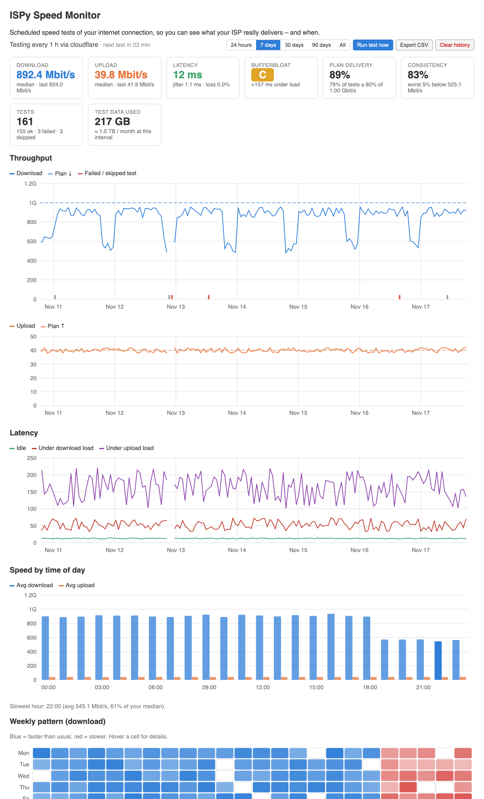

# ISPy — *I spy on my ISP*

**ISPy** is a LuCI app for OpenWrt and GL.iNet routers. It runs internet
speed tests on a schedule and shows what your ISP actually delivers, and when.
It was built for the **GL.iNet GL-BE9300 (Flint 3)** but works on any OpenWrt
21.02+ router with LuCI.


<sub>Dashboard with 7 days of demo data. In this example the evening slowdown shows clearly in the throughput chart, the time-of-day bars and the weekly heatmap.</sub>

## Features

- **Scheduled tests** at any interval (5 min – 1 week). A random offset spreads
  tests so they don't always land at :00. Changes in Settings take effect right away.
- **Three test engines**:
  - **Cloudflare**: built in, needs only `curl`. Uses parallel streams and
    measures latency under load.
  - **Ookla speedtest CLI**: used automatically if installed.
  - **librespeed-cli**: used automatically if installed.
- **Throughput history**: download and upload over time, against your
  advertised plan speed. Failed or skipped tests are marked on the chart.
  Hover any point for details.
- **Latency and bufferbloat**: idle latency, jitter and packet loss, plus
  latency *while the line is loaded* (download and upload separately), turned
  into an A+…F bufferbloat grade.
- **Patterns**: average speed by hour of day, and a weekday × hour heatmap.
  These show when your line gets congested, e.g. *"slowest hour: 22:00, 61% of median"*.
- **Statistics**: last, min, median, average, max and worst-5% for every
  metric. There is also a *plan delivery* score (% of tests reaching at least
  80% of your advertised speed) and a consistency score.
- **Polite to your household**: optionally skips a scheduled test while WAN
  traffic is above a threshold. It retries 3× at 5-minute intervals, then logs
  the test as *skipped*.
- **Data usage**: shows how much data the tests used and the projected monthly
  total at your interval. Useful on metered connections.
- **Multi-WAN**: tests can be bound to a specific interface.
- **Plain CSV storage**, with CSV export from the UI and a size limit with
  automatic trimming.

## Install

### 1. Enable LuCI (GL.iNet firmware)

GL.iNet firmware ships its own web UI. LuCI is an optional add-on. In the GL
admin panel open **System → Advanced Settings** and install/open LuCI, or over SSH run:

```sh
opkg update && opkg install luci
```

LuCI is then at `http://192.168.8.1/cgi-bin/luci`.

### 2. Install ISPy

Download the latest `luci-app-ispy_*_all.ipk` from
[Releases](https://github.com/chaffed/luci-app-ispy/releases), then:

```sh
scp -O luci-app-ispy_*_all.ipk root@192.168.8.1:/tmp/
ssh root@192.168.8.1 'opkg update && opkg install /tmp/luci-app-ispy_*_all.ipk'
```

(`-O` makes `scp` use the legacy protocol, because OpenWrt has no SFTP server by default.)

Open **Services → ISPy Speed Monitor**. Scheduled testing starts enabled with a
1-hour interval, and the first test runs about two minutes after install. Set your
advertised speeds under **Settings → My plan** to get the plan reference lines and score.

The package is architecture-independent (shell + JavaScript). It depends only
on `luci-base`, `curl` and `jsonfilter`, which `opkg` installs if they're missing.

### Optional: Ookla speedtest CLI

The Ookla CLI uses less CPU than curl and tests against your ISP's nearby
servers. On the GL-BE9300 (aarch64):

```sh
cd /tmp
wget https://install.speedtest.net/app/cli/ookla-speedtest-1.2.0-linux-aarch64.tgz
tar xzf ookla-speedtest-1.2.0-linux-aarch64.tgz speedtest
mv speedtest /usr/bin/ && chmod +x /usr/bin/speedtest
```

With the backend set to **Auto**, ISPy uses it from the next test on. By using it
you accept Ookla's [EULA](https://www.speedtest.net/about/eula); ISPy passes
`--accept-license --accept-gdpr` for you.

## Good to know

- **Data usage.** A test moves about `link speed × duration × 2` bytes. On a
  1 Gbit/s line with the default 10 s per direction, that's roughly 1.4 GB per
  test, or about 1 TB/month at an hourly interval. The dashboard shows the real
  figure. Use a longer interval or a shorter duration on metered or capped plans.
- **Rate limits.** Cloudflare's speed-test endpoint rate-limits clients that
  test very frequently. ISPy records this as an error with a clear message
  (`HTTP 429`) rather than a bogus 0 Mbit/s. If you see it, increase the interval.
- **Router CPU.** The test runs *on the router*, so multi-gigabit results can
  be limited by the router's CPU (TLS in curl). If the Cloudflare backend tops
  out below your plan, try more streams, or the Ookla CLI.
- **Storage.** Results are kept in `/etc/ispy/results.csv` (on flash, so they
  survive reboots). One line is written per test, which causes negligible
  flash wear. You can point it at a USB drive in Settings.

## Command line

```text
ispy run          # run one test now and print the CSV line
ispy backends     # show which engines are installed
ispy status       # scheduler state as JSON
ispy results [since-epoch] [limit]
ispy clear        # delete history
```

Log messages go to the system log: `logread -e ispy`.

### CSV format

```text
ts,backend,server,ping_ms,jitter_ms,loss_pct,loaded_down_ms,loaded_up_ms,down_mbps,up_mbps,bytes,status,message
```

`status` is `ok`, `error` or `skipped`. `ts` is a Unix timestamp.

## How it works

| Piece | Path |
|---|---|
| Test engine + scheduler | `/usr/bin/ispy` (POSIX shell, busybox-compatible) |
| Service | `/etc/init.d/ispy` (procd, restarts on config change) |
| Config | `/etc/config/ispy` (UCI) |
| LuCI ↔ router API | `/usr/libexec/rpcd/luci.ispy` (ubus `luci.ispy`: `status`, `results`, `run`, `clear`) |
| UI | `/www/luci-static/resources/view/ispy/{overview,settings}.js` (client-side LuCI views, dependency-free SVG charts) |

The built-in Cloudflare engine:
1. Measures idle latency with `ping`.
2. Runs *N* parallel download streams for the configured duration. Each stream
   reuses one connection for back-to-back 25 MB requests, sized so it overruns
   the deadline by at most one chunk. Meanwhile it pings again to measure
   latency under load.
3. Does the same for upload, using one streamed POST per stream.

Throughput is computed per stream from transfer time only, excluding TCP/TLS
setup, then summed across streams.

## Building from source

```sh
scripts/build-ipk.sh          # -> dist/luci-app-ispy_<ver>_all.ipk (Linux or macOS)
```

Or drop `luci-app-ispy/` into an OpenWrt/LuCI feed (`feeds/luci/applications/`)
and build it with the SDK as usual. Tagging `vX.Y.Z` makes GitHub Actions
attach the `.ipk` to a release.

## Uninstall

```sh
opkg remove luci-app-ispy     # history in /etc/ispy/ is kept; rm -r /etc/ispy to delete it
```

## License

MIT
